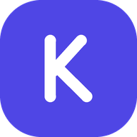
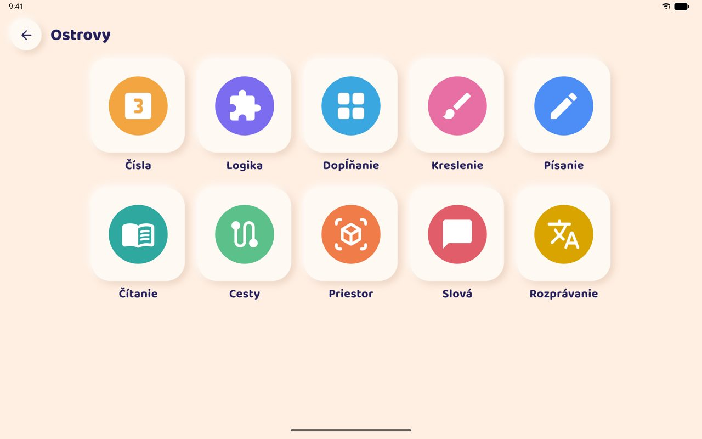
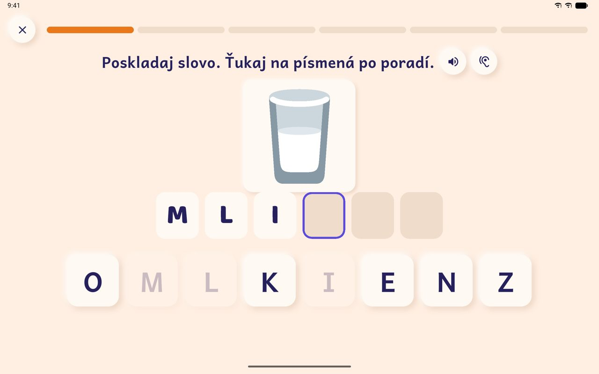
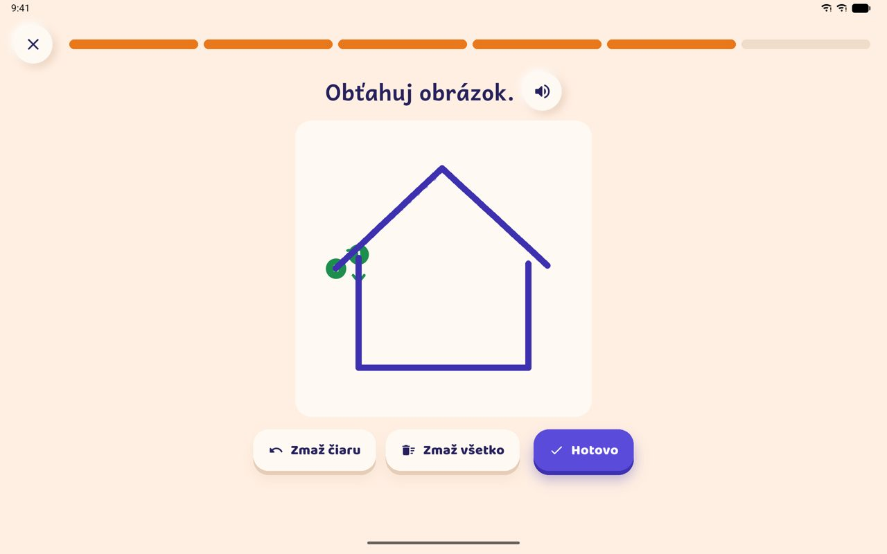
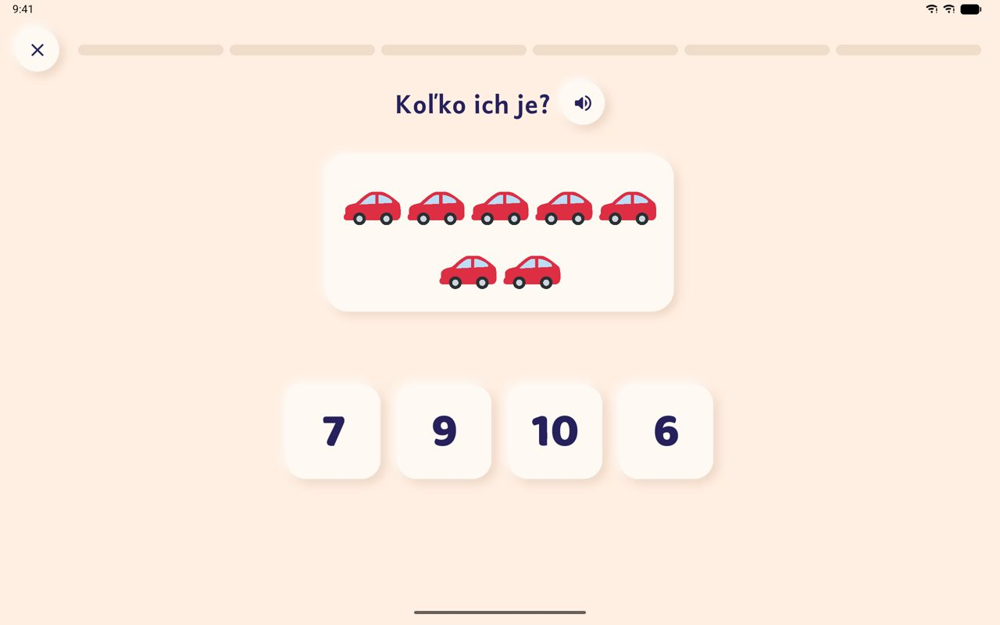

  

<h1 align="center">KLARIN – otvorený obsah úloh pre deti</h1>

  <a href="#slovensky">Slovensky</a> · <a href="#deutsch">Deutsch</a> · <a href="#english">English</a>
    
  
  
  

  
  
  
  

---

## Slovensky

**KLARIN** je appka na učenie pre deti od 4 do 8 rokov: krátke, hravé úlohy s hlasom v slovenčine,
nemčine a angličtine. Bez reklám, dieťa nič nekupuje a údaje sa nepredávajú.

Tento repozitár obsahuje **obsah** appky: zručnosti, slovnú zásobu, texty zadaní a predlohy písmen.
Chceme, aby ho spolu s nami zlepšovali učiteľky, učitelia, rodičia, prekladatelia a všetci, ktorým
záleží na dobrom učení. **Programovať nemusíte.** Väčšinu zmien urobíte priamo na GitHube v prehliadači.

### Ako môžete pomôcť

| Kto ste | Čo môžete urobiť | Kde začať |
|---|---|---|
| učiteľ/ka, vychovávateľ/ka | navrhnúť novú úlohu alebo lepšie stupňovanie | [Nová úloha](../../issues/new?template=nova_uloha.yml) |
| rodič | nahlásiť, čo bolo pre dieťa nejasné alebo príliš ťažké | [Chyba v obsahu](../../issues/new?template=chyba_v_obsahu.yml) |
| prekladateľ/ka, rodený hovoriaci | opraviť nemčinu alebo angličtinu, navrhnúť prirodzenejšie zadanie | [Preklad](../../issues/new?template=preklad.yml) |
| ktokoľvek | navrhnúť nové slovo (s prekladom do troch jazykov) | [Nové slovo](../../issues/new?template=nove_slovo.yml) |
| skúsenejší na GitHube | opraviť text priamo cez Pull Request | [CONTRIBUTING.md](CONTRIBUTING.md) |

Úlohy so štítkom **„good first issue“** sú malé a vhodné na začiatok, so štítkom **„help wanted“** hľadáme pomoc.
Čo by sme radi zlepšili, nájdete v **[ROADMAP.md](ROADMAP.md)**.

### Čo je kde

| Priečinok / súbor | Čo obsahuje |
|---|---|
| `obsah/zrucnosti.json` | ostrovy a zručnosti, úrovne náročnosti a čo sa na nich učí |
| `obsah/slovna_zasoba.json` | slová s prekladom SK/DE/EN, členom v nemčine a úrovňou |
| `obsah/texty/sk.json`, `de.json`, `en.json` | texty zadaní a pochvál, ktoré appka číta nahlas |
| `sablony_pisma.json` | predlohy písmen, čiar a obrázkov na obťahovanie (ťahy v smere písania) |
| `docs/ULOHY.md` | popis všetkých typov úloh po úrovniach |
| `nastroje/kontrola.py` | kontrola obsahu, spúšťa sa automaticky pri každom návrhu zmeny |
| `CONTRIBUTING.md` | podrobný postup: od nápadu po zmenu v appke |

### Ako sa zmena dostane do appky
1. Pošlete návrh (Issue alebo Pull Request).
2. Automatická kontrola overí, že je obsah technicky v poriadku.
3. Pozrieme sa naň pedagogicky aj jazykovo a prípadne sa doplníme v diskusii.
4. Po schválení zmenu zlúčime a dostane sa do najbližšej verzie appky. Prispievateľov uvádzame v poďakovaní.

**Licencia obsahu:** [CC BY-SA 4.0](LICENSE.md). Kód appky nie je súčasťou tohto repozitára.
**Kontakt:** info@brandinstitute.sk · **Prevádzkovateľ:** Brand Institute, o. z. · **Web:** https://klarin.app

---

## Deutsch

**KLARIN** ist eine Lern-App für Kinder von 4 bis 8 Jahren: kurze, spielerische Aufgaben mit Sprachausgabe
auf Slowakisch, Deutsch und Englisch. Ohne Werbung, ohne Käufe durch das Kind, ohne Datenverkauf.

Dieses Repository enthält die **Inhalte** der App: Fertigkeiten, Wortschatz, Aufgabentexte und
Schreibvorlagen. Wir freuen uns über Mithilfe von Lehrkräften, Eltern, Übersetzerinnen und Übersetzern.
**Programmierkenntnisse sind nicht nötig.** Die meisten Änderungen gehen direkt im Browser auf GitHub.

### So können Sie helfen
- **Deutsch verbessern:** Klingt eine Aufgabe unnatürlich oder passt sie nicht zum österreichischen bzw.
  deutschen Schulalltag? → [Übersetzung melden](../../issues/new?template=preklad.yml)
- **Neue Aufgabe vorschlagen:** Was soll das Kind tun, wie wird es schrittweise schwerer?
  → [Neue Aufgabe](../../issues/new?template=nova_uloha.yml)
- **Neues Wort:** mit Übersetzung ins Slowakische und Englische und dem Artikel (der/die/das)
  → [Neues Wort](../../issues/new?template=nove_slovo.yml)
- **Fehler im Inhalt:** → [Fehler melden](../../issues/new?template=chyba_v_obsahu.yml)

Die deutschen Texte stehen in `obsah/texty/de.json`, der Wortschatz in `obsah/slovna_zasoba.json`.
Vorschläge auf Deutsch sind herzlich willkommen. Was wir verbessern möchten, steht in [ROADMAP.md](ROADMAP.md).

**Lizenz:** [CC BY-SA 4.0](LICENSE.md) · **Kontakt:** info@brandinstitute.sk · https://klarin.app

---

## English

**KLARIN** is a learning app for children aged 4 to 8: short, playful tasks with voice in Slovak, German
and English. No ads, the child never buys anything, and data is never sold.

This repository holds the app's **content**: skills, vocabulary, task prompts and handwriting templates.
We'd love help from teachers, parents, translators and anyone who cares about good learning.
**No programming needed.** Most changes can be made right in the browser on GitHub.

### How you can help
- **Improve the English:** does a prompt sound unnatural for a young child?
  → [Report a translation](../../issues/new?template=preklad.yml)
- **Suggest a new task:** what should the child do, and how does it get harder step by step?
  → [New task](../../issues/new?template=nova_uloha.yml)
- **Add a word:** with Slovak and German translations (and the German article)
  → [New word](../../issues/new?template=nove_slovo.yml)
- **Report a content problem:** → [Content issue](../../issues/new?template=chyba_v_obsahu.yml)

English texts are in `obsah/texty/en.json`, vocabulary in `obsah/slovna_zasoba.json`.
Issues and pull requests in English are welcome. See [ROADMAP.md](ROADMAP.md) for what we'd like to improve
and [CONTRIBUTING.md](CONTRIBUTING.md) for the step-by-step process.

**License:** [CC BY-SA 4.0](LICENSE.md) · **Contact:** info@brandinstitute.sk · https://klarin.app
